<a href="https://maric.dev/en">
  <picture>
    <source media="(prefers-color-scheme: dark)" srcset="assets/hero-dark.svg">
    
  </picture>
</a>

<picture>
  <source media="(prefers-color-scheme: dark)" srcset="assets/flow-dark.svg">
  
</picture>

<a href="https://maric.dev/en/work">
  <picture>
    <source media="(prefers-color-scheme: dark)" srcset="assets/work-dark.svg">
    
  </picture>
</a>

<a href="https://maric.dev/en/work/document-management-system">
  <picture>
    <source media="(prefers-color-scheme: dark)" srcset="assets/work-01-dark.svg">
    
  </picture>
</a>

<a href="https://maric.dev/en/work/tripollon">
  <picture>
    <source media="(prefers-color-scheme: dark)" srcset="assets/work-02-dark.svg">
    
  </picture>
</a>

<a href="https://maric.dev/en/work/feelsafehub">
  <picture>
    <source media="(prefers-color-scheme: dark)" srcset="assets/work-03-dark.svg">
    
  </picture>
</a>

<a href="https://maric.dev/en/book">
  <picture>
    <source media="(prefers-color-scheme: dark)" srcset="assets/cta-dark.svg">
    
  </picture>
</a>

<a href="https://maric.dev/en"><picture><source media="(prefers-color-scheme: dark)" srcset="assets/link-site-dark.svg"></picture></a><a href="https://www.linkedin.com/in/maric-dev/"><picture><source media="(prefers-color-scheme: dark)" srcset="assets/link-linkedin-dark.svg"></picture></a><a href="https://www.instagram.com/maric.dev/"><picture><source media="(prefers-color-scheme: dark)" srcset="assets/link-instagram-dark.svg"></picture></a>

